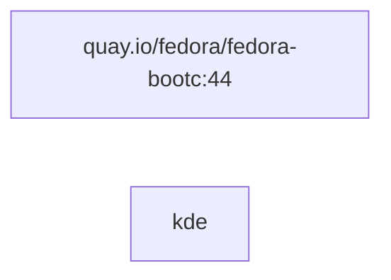

# Creating a bootc image

This tutorial teaches how the repository and schema work by building two
workstation images from the same requirements. It starts with the familiar
components of container building, a script the Containerfile runs and a file
tree copied into the image, and then introduces the schema features that
describe the same work declaratively.

The tutorial is a thorough starting point, not the fastest way to a working
image. Use `tect create repo` to scaffold a repository with sensible defaults
in one command.

## What will you build?

This tutorial creates a repository that generates two workstation images with
different methods. Each workstation includes:

- fedora-bootc:44 as the base image
- KDE Plasma desktop environment
- Firefox browser
- Flatpak and a Flatpak app (Bazaar, a Flatpak app store)

Workstation-1 is hand-written. Its component holds a Bash script to run commands
and a file tree to copy into the image, exactly as a Containerfile would.

Workstation-2 implements the same configuration with the built-in commands. It
uses a component library and a component manifest, which add declarative, family
aware, dependency checked behaviour.

The last part of the tutorial builds the image locally and in CI, producing a
signed image.

> [!NOTE]
> The tutorial creates its own keys and fetches the `tectonic-components`
> library. Run it somewhere disposable.

## Create the repository

First, create a Tectonic repository from scratch. The basic repository
structure looks like this:

```text
tect-tutorial/
├── .gitignore
├── components/
├── image.kdl
└── repo.kdl
```

Navigate to a location where you would like to create this repository and run
the following commands:

```sh
mkdir tect-tutorial
cd tect-tutorial
tect create git
touch repo.kdl image.kdl
mkdir components
```

Below is a summary of each file and directory:

- `repo.kdl` defines repository-wide configuration such as the schema version,
  the component libraries it reads, the security policy and the CI workflows.
- `image.kdl` or `<name>.image.kdl` files define the recipe for an image and its
  flavours: the image's identity, its base image, the components it includes and
  its installation settings.
- `components/` holds the components you create. A component is any directory under
  `components/`.

This is the minimal file and directory structure for a repository. The
documentation provides the full [repository
layout](https://tectonic-os.github.io/tectonic/schema/repository/) schema.

> [!NOTE]
> `tect create git` puts the directory under git control and writes the
> `.gitignore` this repository keeps, which ignores `keys/private/`, `out/`
> and `.cache/`. A directory that is already inside a git repository
> is refused, because a repository does not nest.

> [!NOTE]
> `tect create repo` scaffolds a repository with configuration defaults. This
> tutorial deliberately introduces features one line at a time, so you can
> build an image repository with as much or as little schema as you choose.

## Writing `repo.kdl`

Add the following to `repo.kdl`:

<!-- kdl-file: repo.kdl -->
```kdl
schema-version 1
```

`schema-version` is the only required field. The
[repo.kdl](https://tectonic-os.github.io/tectonic/schema/repo/) documentation
lists every property that this file can hold.

## Creating image definitions

Images are defined with `image` nodes in `image.kdl` or `<name>.image.kdl`
files.

### Writing an `image.kdl` file

Add the following to `image.kdl` in the repository root:

<!-- kdl-file: image.kdl -->
```kdl
schema-version 1

image {
    name "workstation-1"
    base-image {
        base "quay.io/fedora/fedora-bootc:44" {
            family "fedora"
        }
    }
}
```

`base-image` defines the image's base inline. `base` names the bootc image
that the build starts from, by its image reference. The `family` in its block
tells components which package manager and package names the base has.

> [!NOTE]
> `tect` parses every `image.kdl` and `<name>.image.kdl` file at the root of
> the repository, and reads the `image` nodes within them. The filenames are
> purely decorative and allow the repository organisation that suits you:
>
> - `image.kdl` is sufficient for a single image.
> - A repository that builds several images can use named files, such as
>   `fedora-workstation.image.kdl` and `debian-workstation.image.kdl`.
> - The filenames can group images by category, such as `servers.image.kdl`
>   and `iot.image.kdl`, where each file contains several related images.

### `image` nodes

An `image` node defines a single image and its flavours.

Within the image node, `name` is required. It is the os-release name of the
image.

Every other node in the image that is not a property of the image names a
component by its path under `components/`, one segment per node. A segment
that holds component properties, such as `base` or `packages`, defines its
component inline, and no directory is needed. One component is the base that
every layer builds on.

The [image](https://tectonic-os.github.io/tectonic/schema/image/) schema in
the documentation lists every node that an image node can accept.

### Creating a second image

An easier way to scaffold an image file is to use the `tect create image`
command, which provides prompts to configure and generate an image.

#### Adding a component library

The inline base names only the image that the build starts from and its family.
A base component in a library also holds what the base image ships and what it
imports. A component library holds base components and feature components that
you can import. A library is declared in the `sources` node in `repo.kdl`:

<!-- kdl-file: repo.kdl -->
```kdl
schema-version 1

sources {
    components "tectonic-components" {
        url "https://github.com/tectonic-os/library"
        path "components"
    }
}
```

The default library holds base components for Fedora, CentOS Stream, RHEL,
AlmaLinux, Rocky Linux, Debian, Ubuntu and the Universal Blue images under
`base-image/`, and feature components for many use cases.

#### Creating an image with the CLI

To skip the prompts, add the image name and a `--base` argument to the
command. Run the following within the repository:

```sh
tect create image workstation-2 --base base-image/fedora-bootc
```

This copies the library's `base-image/fedora-bootc` component, and the
components it imports, into `components/`, and writes a new
`workstation-2.image.kdl` file that lists only the base. Because the
repository now has two images, `tect` also records `default-image
"workstation-1"` in `repo.kdl`.

The image lists the base component by its path segments, and the base's
segment holds the values this image sets on it:

<!-- kdl-fragment -->
```kdl
base-image {
    fedora-bootc {
        version "44"
        signed #false
    }
}
```

##### The base component

The library's base component holds the facts about the base image, and its
`base` reads the `version` that the image sets:

<!-- kdl-fragment -->
```kdl
provides {
    "rechunking"
    "luks-initramfs"
    "initramfs-generation" witness="/usr/bin/dracut"
    "selinux-policy" witness="/usr/sbin/semodule"
    "ssh" witness="/usr/sbin/sshd"
    "package-manager/dnf5" witness="/usr/bin/dnf5"
    // and the rest of what the base image ships
}

imports "fedora/build-environment" "identity"

base "quay.io/fedora/fedora-bootc:$version" {
    family "fedora"
    bootloader "grub2"
    scap-content "ssg-fedora-ds.xml"
}
```

`base` makes the component a base, and an image holds one base. Its block
states the base's family, its bootloaders and its benchmark content. The
`provides` block declares capabilities baked into the base image that
components might require. It lists one capability on each line. A short list
can go on one line instead, as `provides "rechunking" "luks-initramfs"`. A
`witness` names the path that proves the capability is there, and the build
checks the finished image for it. The `imports` node names the components
every image on this base needs. `tect create image` copied
`fedora/build-environment` and `identity` into `components/`. The image lists
none of them, because the base's import builds each one into every image on
it. `identity` provides `os-release`. Its finalize hook writes the image's own
name into `/usr/lib/os-release`. `scap-content` names the benchmark content
that a compliance scan of the image reads.

`signed` records whether the base image publishes a signature. The base
signature probe workflow corrects it.

## Adding components

### How components work

A component is a directory that encapsulates a feature, or a collection of
related features. A component directory can contain Bash scripts, files to copy
into the image, Containerfile fragments and more.

For a component to be included in an image, the image lists its path relative
to the `components/` directory, one segment per node.

> [!NOTE]
> For these component directories:
>
> - `components/custom-component`
> - `components/dev/git`
> - `components/dev/brew`
>
> They are listed in the image like this:
>
> <!-- kdl-fragment -->
> ```kdl
> custom-component
> dev {
>     git
>     brew
> }
> ```
>
> `dev` is a directory that holds components, so it lists nothing itself.

The [component directory
layouts](https://tectonic-os.github.io/tectonic/schema/components/) documentation
shows every type of file and directory a component can use.

### Creating a component

For this tutorial you will create a new KDE Plasma component.

Create the `kde` component directory:

```sh
mkdir components/kde
```

Create the component script file `components/kde/component.sh`:

> [!NOTE]
> `tect generate` picks up `component.sh` and gives it its own `RUN` layer in the
> generated `Containerfile`.

Edit `components/kde/component.sh` and add the following command, which installs
KDE Plasma from the Fedora base image's package manager:

```sh
dnf5 install -y plasma-desktop
```

A component can also ship a file tree. Everything under a component's `files/`
directory is copied into the image at the same path. Create a default user
configuration:

```sh
mkdir -p components/kde/files/etc/skel/.config
```

and write `components/kde/files/etc/skel/.config/kdeglobals`:

```ini
[General]
ColorScheme=BreezeDark
```

During the build, this tree is copied into the image at the same path, so
`components/kde/files/etc/skel/.config/kdeglobals` lands at
`/etc/skel/.config/kdeglobals`. The generated component script does the copy with
`cp -rT /ctx/components/kde/files /`.

Include the `kde` component in the `workstation-1` image node in `image.kdl`:

<!-- kdl-file: image.kdl -->
```kdl
schema-version 1

image {
    name "workstation-1"
    base-image {
        base "quay.io/fedora/fedora-bootc:44" {
            family "fedora"
        }
    }
    kde
}
```

#### Importing a component from a library

Rather than writing every component from scratch, you can import existing
components from a library to add features quickly and avoid duplicating code.
The library you declared for workstation-2 also holds feature components.

Now run:

```sh
tect import component
```

The first prompt asks which image the components are for. Select `workstation-2`
and press enter:

```ansi
Which image is this for?
  workstation-1
> workstation-2
  None, only add it to the repository
↑↓ navigate • ⏎  select • Esc cancel
```

You will then be prompted with a populated list of components from the default
component library. A component that cannot build on the image's base family is
listed with the reason beside it, and cannot be selected. Tab hides and shows
those components. Scroll to the
`desktop-environment` section, expand it with the → key, and toggle
`kde-plasma` with the space bar:

```ansi
Which components?
  [ ] ▸ browsers
  [-] ▾ desktop-environment
    [ ] tectonic-components/desktop-environment/gamemode
    [ ] tectonic-components/desktop-environment/gnome
  > [x] tectonic-components/desktop-environment/kde-plasma
    [ ] tectonic-components/desktop-environment/krunner-bazaar
  [ ] ▸ fedora
  [ ] ▸ hardening
↑↓ • ←/→ open • ␣ toggle • ⇥ hide • ⏎  confirm • Esc cancel
```

`kde-plasma` requires a `build-environment`, which is explained later in the
[Component manifests](#component-manifests) section. The base already imports
`fedora/build-environment`, so the import asks for nothing more. The last
prompt asks whether the copy tracks its library. Select Yes:

```ansi
Track upstream for `desktop-environment/kde-plasma`?
> Yes
  No
↑↓ navigate • ⏎  confirm • Esc cancel
```

This adds the imported component to `workstation-2.image.kdl`:

<!-- kdl-file: workstation-2.image.kdl -->
```kdl
schema-version 1

image {
    name "workstation-2"

    layout {
        bootloader "grub2"
    }

    base-image {
        fedora-bootc {
            version "44"
            signed #false
        }
    }
    desktop-environment {
        kde-plasma
    }
}
```

The import copies each component into `components/`, at its path in the library,
and the image lists it like a component you wrote yourself.
`components/components.lock.kdl` records the library each copy came from and what
its content hashed to. The entry of a tracked copy carries `track`. A tracked
copy is immutable: if it no longer matches its entry, then `tect check`,
`tect generate` and `tect build` refuse it. An untracked copy is yours to edit, and `tect why` shows that it
was edited.

A tracked copy changes only when its library moves. `tect fetch components`
copies each tracked component again from its library and records the new hash in
the lock. The `update-components` workflow runs it on a schedule and opens a pull
request. To edit a tracked copy, first run `tect set component <path>
--untracked`, which makes the copy yours.

If `components/` already holds a component at that path, then the import asks
whether to list the component you hold or to import the library's under another
name, such as `desktop-environment/kde-plasma@1`.

#### Component manifests

Looking at `components/desktop-environment/kde-plasma`,
you will see it contains a `manifest.kdl` file. This is a component manifest. It
includes the following nodes:

<!-- kdl-fragment -->
```kdl
targets "fedora" "debian" "ubuntu"

provides {
    "graphical-session"
    "wayland"
    "plasma-desktop" witness="/usr/bin/plasmashell"
}
provides "display-manager" exclusive=#true

requires "build-environment"

packages {
    "plasma-desktop"
    "plasma-workspace"
    "plasma-nm"
    "dolphin"
    "konsole"
    "kate"
    // and the rest of the Plasma application set
}

on "fedora" {
    packages "plasma-login-manager" "kcm-plasmalogin" "kwin" "kscreenlocker"
}

on "ubuntu" {
    packages "plasma-session-wayland" "plasma-session-x11"
}

on "debian" "ubuntu" {
    packages "systemsettings" "sddm" "kwin-wayland"
}
```

##### Manifest fields

- **targets** restricts this component to the base families it lists.
- **provides** and **requires** name capabilities a component provides or needs
  from other components. For example, a GUI app can declare that it requires a
  `graphical-session`, and components that add a desktop can declare that they
  provide it. `witness` names the path that proves the capability is in the
  finished image. `exclusive=#true` says that a second provider conflicts, so
  `tect check` refuses an image or flavour that would hold two display
  managers.
- **packages** resolves to the base image's package manager, which the
  `build-environment` component supplies for each family. A short list goes
  on one line, and a long one goes in a block with one name on each line.
  Each `packages` node installs as one batch, so an `enablerepo=` on the node
  covers every name in it.
- **on "fedora" "rhel" "debian" "ubuntu"** gates any of the component's
  top-level configuration for one or more families, so a component can handle
  the differences between them.

### Creating a component with the CLI

You can create components with the built-in `tect create component` command, which
scaffolds a package component.

Create a component named `browser`, which installs the `firefox` package:

```sh
tect create component
```

The command prompts for a name, an optional description and supported
families, then asks whether the component installs a package and which images
list it:

```ansi
component name: browser

description (optional):

supported base families, separated by spaces (optional):

Does this component install packages? Yes

package names, separated by spaces: firefox

Which images list it?
  [ ] workstation-1
> [x] workstation-2
↑↓ navigate • ␣ toggle • ⏎  confirm • Esc cancel
```

Alternatively, you can configure a component with command arguments:

```sh
tect create component browser --image workstation-2 --pkg firefox
```

#### `create component` arguments

**`--image`**: lists the new component in the named image.
**`--pkg`**: adds these package names to the component.
**`--no-tui`**: asks nothing; a command that would prompt fails and names the
flag. Use it in scripts with all arguments supplied.

Review the `manifest.kdl` file in `components/browser/`:

<!-- kdl-file: manifest.kdl -->
```kdl
schema-version 1

packages "firefox"
```

#### Declaring dependencies

A missing dependency is expensive to catch during the image build or at
runtime.

Declaring `provides` and `requires` in a component's `manifest.kdl` manifest lets
`tect` catch them before the build files are generated.

Since Firefox is a GUI app, it requires a graphical session. Add the following
line to `components/browser/manifest.kdl`:

<!-- kdl-file: manifest.kdl -->
```kdl
schema-version 1

packages "firefox"

requires "graphical-session"
```

If an image lists `browser` and no component in the repository provides
`graphical-session`, then `tect check` and `tect generate` report the missing
dependency immediately:

```
  × `browser` requires `graphical-session`, which nothing enabled provides
   ╭─[./components/browser/manifest.kdl:5:1]
 4 │
 5 │ requires "graphical-session"
   · ────┬───
   ·     ╰── unsatisfied
   ╰────
  help: no component in the repository declares `provides "graphical-
        session"`, and neither does the base `base-image/fedora-bootc`. `tect
        import component` lists what the declared libraries provide
```

Nothing adds a component to the image on its own. `tect check`'s help names
each component under `components/` that could provide the capability, to add
to the image. If none is there, then the help names `tect import component`,
which lists what the declared libraries provide. `generated/plan.json`
records whether each component is `listed` or `imported`, and names the
component that imported it. `tect why` names that component too.

### Hook components

The components so far add features to the image. A component can also add
functionality to the `tect` tool itself and to the generation stage.

#### Key hook

A component can hook into the key generator, `tect create key`, and add new key
pairs with the `key` node in its `manifest.kdl` file. The private key then goes
into a secrets vault, and the public key is installed at the location the
component declares in the image.

The `key` node takes these fields:

<!-- kdl-fragment -->
```kdl
key "cosign" {
    generator "cosign"
    public "/etc/pki/containers/cosign.pub"
    private "cosign.key"
}
```

`generator` is one of `cosign`, `openssl` or `ssh-keygen`.

Add the signature-policy component, `updates/signature-policy`, to the image
with:

```sh
tect import component updates/signature-policy --image workstation-2
```

then create the cosign keys with:

<!-- transcript-command: tect create key cosign -->
```sh
tect create key cosign
```

This prints:

<!-- transcript-output: tect create key cosign -->
```bash
Private key written to cosign.key
Public key written to cosign.pub
wrote keys/public/etc/pki/containers/cosign.pub
wrote keys/private/cosign.key

the key carries no password, which is what the build workflow decrypts it with.

next:
  commit keys/public/etc/pki/containers/cosign.pub
  gh secret set SIGNING_SECRET < keys/private/cosign.key
```

> [!NOTE]
> The `.gitignore` that `tect create git` wrote already ignores
> `keys/private/`. `tect create key` warns when nothing ignores the private
> half.

#### Collection components

A component can also collect and organise files from the components it depends on.

For example, a Flatpak component can collect a `flatpaks.list` file from any
component in the image.

Add Flatpak and Bazaar to workstation-2 with:

```sh
tect import component flatpak --image workstation-2
tect import component apps/bazaar --image workstation-2
```

The Flatpak `manifest.kdl` at `components/flatpak` holds:

<!-- kdl-fragment -->
```kdl
collects "flatpaks.list" into="/usr/share/flatpak-defaults/apps.list" priority=500

provides "flatpak" witness="/usr/bin/flatpak"
```

The Bazaar component at `components/apps/bazaar` has a manifest that requires
`flatpak` and `graphical-session`, and a `flatpaks.list` file holding:

```text
io.github.kolunmi.Bazaar
```

#### Build helper script components

A component can provide build helper scripts to every other component with the
`helpers` node in `manifest.kdl`.

For example, the `fedora/build-environment` component provides
`lib/family.sh`, which other components use to install packages with the right
command for the family.

## Check the repository

Run the check:

```sh
tect check
```

Errors name what is missing.

## Generate and review the build files

```sh
tect generate
```

This creates a `generated` directory. Each image gets a
`generated/<image>/` directory holding its `Containerfile`, its component scripts
under `components/`, `finalize.sh` and the capability graph (`graph.md`).
`generated/plan.json` records the resolved plan, and `generated/lib/` and
`generated/scripts/` hold the shared helpers and scripts.

`tect graph` prints the capability graph generated at
`generated/workstation-1/graph.md`:

<!-- transcript-command: tect graph -->
```sh
tect graph
```

<!-- transcript-output: tect graph -->
````markdown
# workstation-1 capability graph

GENERATED FILE, do not edit.

An arrow points from a provider to what needs it, dotted for `after`,
which orders the build without requiring anything. Layers build left to
right.


````

`tect summary` prints what the target is made of:

<!-- transcript-command: tect summary -->
```sh
tect summary
```

<!-- transcript-output: tect summary -->
```markdown
1 component, the ungated set.

| Component | Description | Options | Satisfies | Refuses |
| --- | --- | --- | --- | --- |
| `kde` |  |  |  |  |
```

`tect why bazaar` prints where each part of the Bazaar component came from:

<!-- transcript-command: tect why bazaar -->
```sh
tect why bazaar
```

<!-- transcript-output: tect why bazaar -->
```markdown
# apps/bazaar

Bazaar, the Flatpak storefront

## Where it is built

workstation-2

## What it exchanges

| Direction | What | With |
| --- | --- | --- |
| provides | `bazaar` | nothing |
| requires | `flatpak` | flatpak |
| requires | `graphical-session` | desktop-environment/kde-plasma |

## What it claims

Nothing. It declares no `satisfies`.

## Where it came from

| Content | Hash |
| --- | --- |
| declared | `0329331475c534107db0404630eb33cef466ca52542b1cd67d70b718ca51c07c` |

| Collection | Locator | Selector | Verifier | Tracker |
| --- | --- | --- | --- | --- |
| `tectonic-components` | https://github.com/tectonic-os/library | not declared | not declared | none |

It tracks its library, and its content still matches what was imported. An edit to it stops `tect check`, `tect generate` and `tect build`.

## What it pulls in

Nothing. It declares no `asset`.

## Third-party repositories

None. It declares no `copr` and ships no `repo.sh` file.
```

## Build the image

To build the image run:

<!-- transcript-command: tect build -->
```sh
tect build
```

`tect build` verifies the generated files, then builds the default image. Name
another target, such as `tect build workstation-2`, to build it instead. With
the default buildah backend, the image lands in the local Podman store. The
walkthrough's default tag is printed before the build starts:

<!-- transcript-output: tect build -->
```text
tect: tags workstation-1:latest
```

Once `IMAGE_REGISTRY` is set, or the repository has a GitHub `origin`,
`tect registry ref` prints the full reference the image publishes under. For
example:

<!-- transcript-command: IMAGE_REGISTRY=ghcr.io/example tect registry ref -->
```sh
IMAGE_REGISTRY=ghcr.io/example tect registry ref
```

<!-- transcript-output: IMAGE_REGISTRY=ghcr.io/example tect registry ref -->
```text
ghcr.io/example/workstation-1:latest
```

## Publish with CI

`tect set workflows` chooses the GitHub Actions workflows and writes them into
`repo.kdl`. Pick `build`, the workflow that builds and publishes the image.
`tect generate` then writes `.github/workflows/build.yml`. Push the repository
to GitHub, and the workflow builds the image, pushes it to
`ghcr.io/<owner>/<image>`, signs the digest with the key from
`SIGNING_SECRET`, attests its SBOM, and runs the scans. The schedule in the
workflow comes from `at=`, the image version comes from the build, and
`tect registry namespace` prints the namespace the image publishes under.
Pick `update-components` as well, and the tracked components are refreshed once a
week.
[repo.kdl](schema/repo.md#workflows) documents the block.
